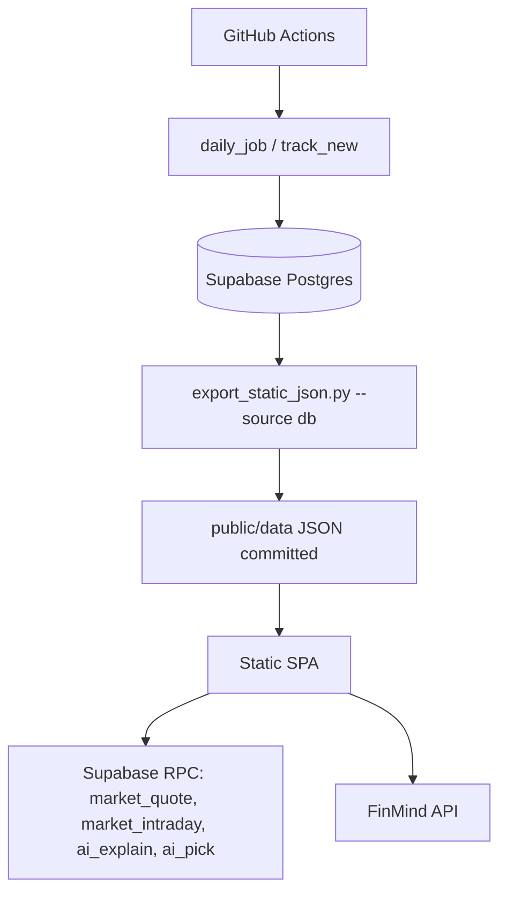

# Agent Handover

Taiwan stock decision dashboard. Updated 2026-10-18 after the Fly.io backend was retired. Start with [README.md](README.md) (docs index).

## Current Runtime

| Area | Stack | Entry |
|---|---|---|
| Frontend | React + Vite SPA, hash router | `src/main.jsx`, `src/App.jsx`, `src/pages/*` |
| Backend | None (no HTTP server). Python scripts run in GitHub Actions | `backend/daily_job.py`, `track_new.py`, `export_static_json.py` |
| Data store | Supabase Postgres (`DATABASE_URL`) | `backend/firebase.py`, `firebase_cache.py` (legacy names, psycopg2) |
| Frontend data | Static `public/data/*`, Supabase RPC/tables, FinMind from browser | `src/lib/` |
| Deploy | Render static + GitHub Pages | `render.yaml`, `.github/workflows/deploy-pages.yml` |

## Flow

## Working Rules

- No `/api/*` exists anymore. Do not add frontend calls to the old Fly.io/Render API.
- `export_static_json.py --source api` points at the retired fly.dev API and is dead; use `--source db`.
- Tables: `stock_daily`, `chip_daily` (`backend/schema.sql`); `transactions`, `import_presets`, `watchlist`, `profiles`, `holding_settings`, `track_requests` and others in `supabase/migrations/`.
- AI uses Groq via Supabase Vault (`supabase/migrations/005_ai_picker.sql`).
- Bump visible frontend version labels for user-visible frontend changes.
- Do not assume generated chip seed data is real institutional data.

## Known Code Areas

| Task | Files |
|---|---|
| App shell / nav | `src/App.jsx` |
| Pages | `src/pages/` |
| Daily pipeline | `backend/daily_job.py`, `.github/workflows/update-data.yml` |
| Static export | `backend/export_static_json.py`, `payload_builder.py` |
| Analysis | `backend/analysis_engine.py`, `perspective_engine.py`, `signal_engine.py` |
| Migrations | `supabase/migrations/`, `.github/workflows/db-migrate.yml` |

## Historical docs

[API_REFERENCE](API_REFERENCE.md), [BACKEND_ARCHITECTURE](BACKEND_ARCHITECTURE.md), [FIREBASE_SCHEMA](FIREBASE_SCHEMA.md), [BUSINESS_RULE_ENGINE](BUSINESS_RULE_ENGINE.md), [FRONTEND_ARCHITECTURE](FRONTEND_ARCHITECTURE.md) describe the removed backend; see banners on each.
